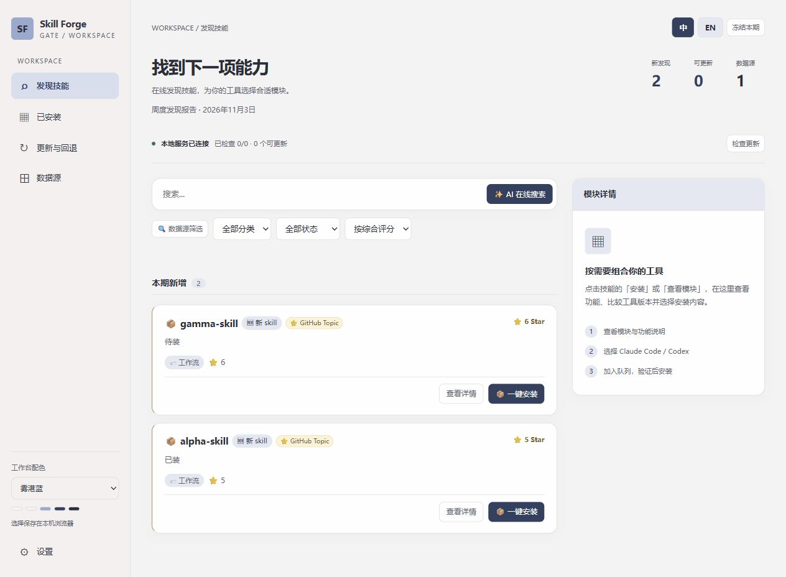

# Skill Forge Gate

[](LICENSE)

**面向 Claude Code 与 Codex 的本地技能工作台。**

在一个面板里发现新技能、了解模块用途、选择工具版本，并完成安装、同步、更新和回退。Skill Forge Gate 将分散在 GitHub 和第三方数据源中的技能整理成可浏览、可筛选、可维护的本地工作台，保留失败原因和版本记录；完整版还在安装前展示安全预检结果。

目前面向 **Windows 10 / 11**，采用本地 Python 服务与浏览器面板。项目名为 **Skill Forge Gate**，技能名与安装目录名为 **`skill-forge`**。



*工作台预览：雾港蓝主题，使用测试数据展示。*

## 选择发行版

两个版本共用安装管理代码，分别打包、同时维护。面板顶部会显示当前版本。

| 能力 | 完整版 `full` | 无核版 `coreless` |
|---|---|---|
| 发现、AI 搜索、翻译、工具版本与模块选择 | 支持 | 支持 |
| 安装、失败重试、同步、更新与回退 | 支持 | 支持 |
| L1–L5 技能安全验证内核 | 包含；各层按策略执行或跳过 | 不包含 `verify/` 和 `sandbox/`，不执行技能安全预检 |
| 安装记录 | 保存实际检查结果 | 明确标为「未做安全验证」 |
| 路径边界、同名目录保护、备份、凭据存储 | 保留 | 保留 |
| 安装包 | `skill-forge-gate-full.zip` | `skill-forge-gate-coreless.zip` |

同一 Windows 用户账户选择一种安装，两版使用相同的运行目录和端口，不能同时运行；面板没有版本切换开关。源码仓库默认是完整版。无核版的环境、安装与升级步骤见 [无核版说明](editions/coreless/README.md)。

从源码目录同时构建两个干净安装包：

```powershell
python scripts/build_release.py
```

产物位于 `dist/`，打包使用已跟踪的公开代码，不携带实际安装清单、配置、密钥、日志或发现记录。无核版管理器升级使用新版 coreless 包；技能本身仍可在面板更新和回退。

## 你可以用它做什么

| 需求 | 工作台提供的能力 |
|---|---|
| 找到适合当前任务的技能 | 浏览定期发现结果，按来源、分类和状态筛选；用自然语言发起在线搜索，从 GitHub 与已保存的数据源获取候选技能 |
| 安装前看懂一个项目 | 预览内部子模块及功能说明；首次安装选择需要的模块和适用工具，支持公开模块描述的中文翻译 |
| 区分 Claude Code 与 Codex 版本 | 展示可识别的工具版本供选择，保留同名独立版本，避免直接覆盖另一工具的安装 |
| 知道安装为什么失败 | 查看精简原因，需要时展开详细信息；继续其他模块，并保留失败项供重试。完整版同时展示安全预检拒绝原因 |
| 维护已安装的技能 | 检查更新、安装历史提交版本、查看本地备份并回退；更新前备份，完整版同时执行预检 |
| 在两个工具之间复用技能 | 启用 Codex 同步，把适合共享的技能链接到 Codex 技能目录；独立版本继续分别管理 |

## 从发现到使用

1. **发现技能**：浏览本期列表，或输入需求后点击「AI 在线搜索」。
2. **选择模块**：点击「一键安装」或「查看模块」，阅读功能说明，选择 Claude Code / Codex 版本和需要安装的子模块。
3. **安装所选模块**：加入安装队列；完整版展示各层预检结果，无核版标明未做安全验证。出现部分失败时，可继续其他模块，之后重试失败项。
4. **持续维护**：在「已安装」查看状态，在「更新与回退」检查新提交、选择历史版本或恢复本地备份。

首次安装会展示模块选择；一个仓库中的多个技能不必全部安装。安装失败的简要原因直接显示，详细原因按需展开。

## 在线发现与 AI 辅助

### 搜索从哪里获取结果

普通搜索框用于筛选面板中已有的发现结果；**点击「AI 在线搜索」会发起新的在线检索**，访问 GitHub 与已保存的外部数据源。没有检索结果时会尝试公开技能目录，结果仍需根据实际来源判断。

搜索先在本机把需求转换为通用功能标签，再匹配在线获取的候选技能。启用 DeepSeek 后，可由模型辅助排序；未配置模型或模型不可用时，使用本地排序，在线拉取仍会进行。数据源连接失败时会提示，其他来源返回的结果可以继续使用。

### 第三方数据源何时拉取

在「数据源」中添加 GitHub 仓库或受支持的 HTTPS JSON API 后，点击「保存」使配置生效。**添加和保存本身不会立即拉取**；点击「立即拉取」、后续定期扫描或发起 AI 在线搜索时，才会访问已保存的来源。「立即拉取」会先保存当前配置。

自动发现按七天间隔检查。来源的返回格式、连接状态和访问限制会影响实际结果。

### 翻译和搜索共用一个模型配置

在「设置」中选择 DeepSeek、模型并保存密钥，**模块描述翻译与 AI 模糊匹配共用同一个 API 密钥**，调用费用由模型服务商计收。发现列表会复用本机翻译缓存，没有可用翻译时显示原文。

当前接通 **DeepSeek 官方接口**。其他商业模型的适配接口已预留，仍需单独实现和授权；不能仅填写任意 API 地址就使用现有密钥调用。具体发送内容见文末数据安全说明。

## Claude Code 与 Codex 如何协作

| 对象 | 当前处理方式 |
|---|---|
| 通用技能或共享模块 | 可通过目录链接同步到 Codex 使用的 `~/.agents/skills` |
| Claude Code / Codex 专用版本 | 在安装预览中按工具选择；已有独立版本保留，不用共享链接覆盖 |
| 工具专属插件、MCP 或 Hooks | 仍需按对应工具的安装方式配置；复制技能文件不会自动完成插件注册 |

在已部署的 `skill-forge` 目录中，可以启用技能同步：

```powershell
python -m daemon.codex_sync --enable
```

同步让文件可被发现，实际是否适用于某个工具仍取决于技能自身的指令和依赖。遇到已有目录冲突时，先查看同步报告再处理。

## 清爽工作台与十套配色

左侧导航分为「发现技能」「已安装」「更新与回退」「数据源」，右侧展示模块说明与安装选择；窄屏会调整为浮动模块面板。

默认主题为 **雾港蓝**，另有 **岩苔绿、暖陶橘、烟霞紫、潮汐青、麦穗金、夜航靛、山莓红、杏砂棕、石墨银** 九套原创配色。可在工作台左下方切换，选择保存在当前浏览器，刷新后保留。

Windows 后台任务以隐藏窗口方式启动，减少检查更新、安装和更新时的 CMD 弹窗；密钥录入使用可见的系统原生密码框。

## 安装环境与开始使用

### 必需环境

| 项目 | 需要配置什么 |
|---|---|
| 操作系统 | **Windows 10 / 11**；当前完整工作流在 Windows 上验证 |
| Python | **Python 3.12 为已验证环境**；安装时勾选加入 PATH，确保 `python` 和 `pythonw` 来自同一套安装 |
| Git | 安装 **Git for Windows**，确保 PowerShell 中可运行 `git`；使用 `SKILL.md` 中的 `.sh` 脚本时，还需 Git Bash 中的 `bash` 和可用的 `python3` 命令 |
| 浏览器 | 使用支持现代 JavaScript 的浏览器打开本地 HTML 面板；无需额外部署网页服务器 |
| PowerShell | 使用 Windows 自带的 PowerShell；后台任务注册与原生密钥录入会用到它 |
| 目录与端口 | 当前用户能写入 `~/.claude/skills/skill-forge`；面板操作需要本地服务监听 `127.0.0.1:18970`，该端口不能被其他程序占用 |
| 网络 | 发现、安装和更新需要访问 GitHub 及所选数据源；使用 DeepSeek 时还需直连其官方 HTTPS 接口。代理配置见安装说明 |

要在 AI 工具中实际调用安装的技能，还需自行安装并配置 **Claude Code 或 Codex**，按需要选一个或两个。只浏览工作台不要求两个工具同时安装；技能自身需要的运行环境、插件或账户仍应按该技能说明配置。

### 按功能选配

| 想使用的功能 | 额外配置 |
|---|---|
| 保存 GitHub / DeepSeek 密钥 | 安装 `pywin32`，启用 Windows 凭据管理器读写 |
| 完整版 L3 敏感路径策略检查 | 安装 `pyyaml`；缺少时报告会提示对应策略未生效。无核版不需要 |
| 提高 GitHub API 可用额度 | 可选配置 GitHub Token；日常读取用途无需授予仓库写权限 |
| 模块翻译与模型辅助搜索 | 配置 DeepSeek API 密钥、选择模型及 DeepSeek 后端；两项功能共用密钥，按服务商计费 |
| 面板持续可操作 | 配置常驻桥接服务 `SkillForgeBridge`；首次扫描临时启动的服务会在五分钟后结束 |
| 登录后定期发现技能 | 可选注册 `SkillForgeWatcher` 任务；注册需要相应任务计划权限，日常面板操作无需管理员运行 |

**无需安装本地大模型。** Claude Code / Codex 的登录状态不等于已配置 DeepSeek API。日常使用无需 Node.js；Node.js 与 `jsdom` 只用于面板开发测试。L5 当前按隐私策略跳过，无需为其安装 Docker。

### 安装与首次启动

先在 PowerShell 中检查命令是否可用：

```powershell
python --version
python -m pip --version
git --version
Get-Command python, pythonw, git
```

完整版可克隆到固定目录；也可将对应 ZIP 中的 `skill-forge` 文件夹解压到该位置。以下克隆命令取得完整版，无核版请使用 coreless 包：

```powershell
git clone https://github.com/fushengsan3/skill-forge-gate.git "$env:USERPROFILE\.claude\skills\skill-forge"
Set-Location "$env:USERPROFILE\.claude\skills\skill-forge"
```

需要密钥管理和敏感路径策略检查时，在同一套 Python 环境中安装这两个可选依赖：

```powershell
python -m pip install pywin32 pyyaml
```

启动首次扫描：

```powershell
python daemon\watchdog.py
```

请保留目录名 `skill-forge`。扫描完成后，打开生成的 `discover/latest.html`。面板显示「本地服务已连接」时，才可执行安装、更新与设置保存等操作；仅打开 HTML 不会自动启动服务。

按 [安装与部署说明](安装部署说明.md) 配置常驻桥接和可选的登录扫描任务。GitHub Token 与 DeepSeek 密钥都从「设置 → 密钥」录入，无需创建 `.env`；选择 DeepSeek 后还需选择模型并保存。安装依赖或更换 Python 后，应重启桥接服务。

## 文档与反馈

- [安装与部署说明](安装部署说明.md)：环境准备、服务启动、网络配置与排错。
- [技能调用说明](SKILL.md)：在 Claude Code 中调用管理流程。
- [提交问题或建议](https://github.com/fushengsan3/skill-forge-gate/issues)：请提供操作步骤、脱敏后的错误信息和预期结果。
- [MIT License](LICENSE)：项目许可证。

## 数据安全与使用边界

### 哪些信息保存在本机

GitHub Token 与 DeepSeek API 密钥存放在 **Windows 凭据管理器**，由系统按当前用户加密保存，后端在请求时读取；密钥不交给面板页面，也不写入项目的普通配置文件。**本地保存不等于永不联网发送：访问对应服务时，密钥仍需作为认证信息发送。**

已安装清单、外部数据源配置、发现结果、翻译缓存、版本备份和运行日志保存在本机文件中，主题选择保存在浏览器中。这些普通文件并不因密钥使用加密存储而自动加密，其他有相应本机权限的程序仍可能读取它们。

### 哪些操作会访问外部服务

| 操作 | 接收方与发送内容 |
|---|---|
| 发现技能、克隆、检查更新、来源检查 | GitHub 或对应仓库服务接收仓库访问请求；搜索使用本机提取的通用功能标签。配置的 GitHub Token 用于 GitHub API 认证 |
| 拉取外部数据源、尝试公开目录 | 用户配置的 HTTPS 来源或公开技能目录接收访问请求；来源本身仍需由用户判断是否可信 |
| DeepSeek 辅助搜索 | 仅向 DeepSeek 官方接口发送 API 密钥进行认证，以及通用需求标签、候选编号和功能标签；不发送原始搜索句子 |
| DeepSeek 模块翻译 | 仅向 DeepSeek 官方接口发送 API 密钥进行认证，以及经过过滤的公开模块描述和编号 |

模型请求不附带本机路径、私人文件内容或完整已安装清单。公开描述发送前会过滤路径、邮箱、IP 和疑似密钥等信息；**规则过滤不能保证识别所有敏感内容**。请勿把私人信息填入公开描述或第三方数据源地址。

联网服务仍能获得连接所需的 IP 等网络信息；若使用网络代理，请求也会经过该代理。DeepSeek 请求当前采用官方 HTTPS 接口直连，不跟随重定向。选择「本地排序」只停用模型调用，搜索和数据源拉取仍会联网。服务端的留存与处理受对应服务商政策约束，本项目无法替服务商作不留存的保证。

### 分享文件时需要注意什么

**不要直接上传整个运行目录，也不要公开生成的 `discover/latest.html`。** 生成面板包含本地桥接服务的访问密钥，持有它的本机程序可能调用安装、卸载等接口。桥接服务绑定 `127.0.0.1` 并校验请求来源与密钥，这仍不能代替操作系统的访问保护。

配置、日志、备份和发现存档可能包含路径、已安装技能或自定义来源。仓库已排除这些运行数据，但手动打包、截图、粘贴日志或提交问题前仍需检查并脱敏。README 中的预览图使用测试数据，不是实际运行目录导出的面板。

### 安装检查能保障到哪里

**无核版不包含以下验证内核，安装、更新和回退不会执行 L1–L5，记录明确标为未做安全验证。** 它保留安装器的路径边界和文件操作保护，但不判断技能内容是否可信。

完整版提供 L1–L5 的逐层结果，当前实际状态如下：

| 检查层 | 当前范围 |
|---|---|
| L1 格式 | 检查技能入口与基本结构 |
| L2 来源 | 查询 GitHub 来源信息；受权限、限流或网络影响时可能跳过 |
| L3 内容 | 在本机匹配可疑内容与配置策略，存在误报和漏报的可能 |
| L4 冲突 | 执行本地冲突检查；会上传技能内容的远程分析在当前隐私策略下禁用 |
| L5 沙箱 | **当前隐私策略下跳过**，不会上传本机技能文件；配置密钥或 Docker 不会自动启用 |

**`SKIPPED` 表示未执行，不是通过。** 完整版面板安装会阻止 `REJECT` 和静态检查错误；`REVIEW` 项仍可安装，并记录有限信任状态和原因。因此，安装成功不等于所有检查均通过，更不等于安全认证。

技能交给 Claude Code、Codex 或其他工具运行后，仍可能按该工具授予的权限读取文件、执行命令或联网，安装预检不提供运行时隔离。

### AI 生成代码风险

**本项目的代码由 AI 生成并持续迭代，配套测试与文档也包含 AI 生成内容，尚未经过独立的专业安全审计。** AI 生成、测试通过或界面显示安装成功，都不能作为代码正确或安全的保证。

- **程序可能仍有缺陷**：逻辑、边界条件、依赖兼容与文件操作中的错误，可能导致安装失败、更新异常、配置覆盖或数据丢失；备份和回退机制也可能存在尚未发现的问题。
- **测试可能遗漏同类错误**：代码与测试由 AI 编写时，可能共享相同的错误假设。已有测试覆盖特定场景，不能证明其他系统、版本或操作组合都可靠。
- **安全检查可能误判**：检查规则本身也需要验证，可能漏掉恶意行为或误拒正常模块。尤其是当前未运行的 L5，不能被理解为已经提供沙箱隔离。
- **AI 辅助内容可能不准确**：模块翻译、功能匹配和排序可能误解原意；安装前应结合仓库原文、模块要求和检查原因判断。

首次使用宜先用少量、非关键技能验证安装与回退流程；涉及重要文件时保留独立备份。将本工具用于生产或敏感数据环境前，应由具备相应能力的人员审查相关代码与权限。不要仅凭 AI 推荐、安装成功或检查结果，向未知技能授予访问私人文件或执行高权限命令的能力。
